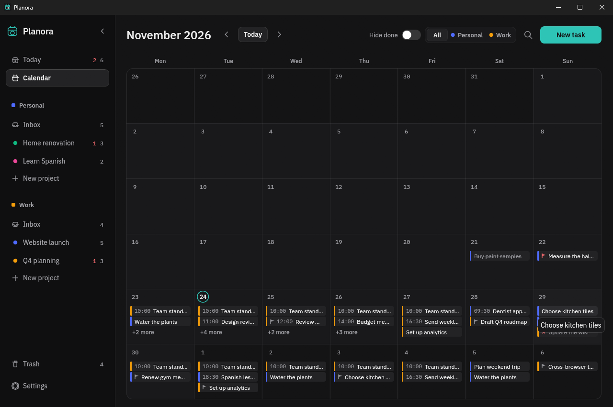
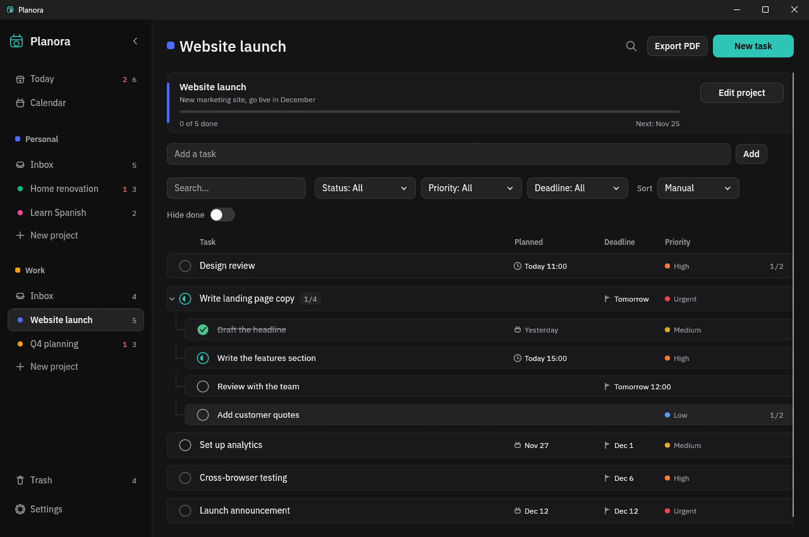
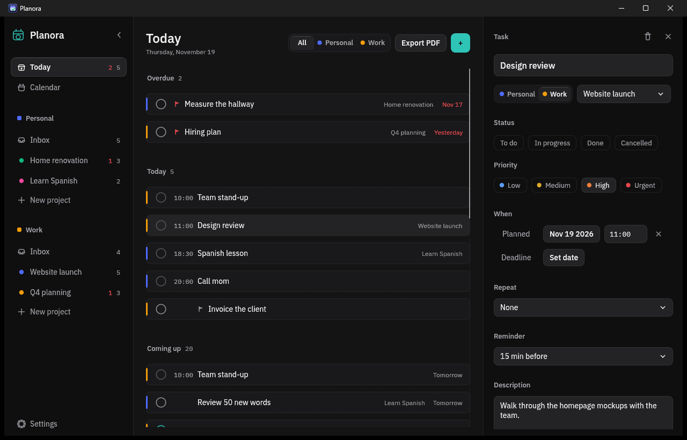

# Planora

A calm, local planner for tasks, projects and your calendar, for Windows and Linux. It works fully offline, with no account and no cloud. Part of the [NIMVORO](https://github.com/GrigoryyKach/nimvoro) suite.



## Features

- **Two profiles, one calendar.** *Personal* and *Work* each have an Inbox (tasks without a project) and projects. The calendar shows both, and a filter switches between All, Personal and Work.
- **Month calendar.** Square day cells with chips for planned tasks and deadlines. Only a deadline in the past makes a task overdue (red); a past plan date is just shown muted. Done and cancelled tasks are struck through (done has a green check, cancelled a red cross), today is highlighted. Click a day for its list, click a chip to edit, drag a chip to another day to reschedule it.
- **Today view.** Today's items, overdue items and what is coming in the next week.
- **Tasks.** Only the title is required. Optional: description, links (with Open and Copy), status, priority, a deadline and a planned day, each with an optional exact time, a checklist (`2/5` progress), repeat and a reminder.
- **Projects.** Progress card, colour, archive. Lists have filters (status, priority and deadline as multi-select dropdowns, plus a search box), sorting (manual, deadline, priority, newest) and quick actions on every row: click the status to cycle it, right-click to set status, priority, deadline or plan, to move, duplicate or delete. Deleting offers Undo.
- **Repeats.** Daily, weekdays, weekly, monthly (the 31st becomes the last day of shorter months) or every N days, with an optional end date. Completing one occurrence does not complete the series.
- **Reminders.** A system notification at the plan time and at the deadline time (when they have a time), or 5, 10, 15 or 30 minutes before. One per-task choice applies to both; the default is in Settings. Planora stays in the tray when you close the window, and starts minimised to the tray with the system. Reminders missed while it was off appear once in a "Missed reminders" list. Clicking a notification opens the task.
- **Export to PDF.** A project, the Inbox, the Today view or a single day (from the day panel) becomes a simple A4 task list: a header, then one task per line with a checkbox and the time. Filters such as "Hide done" are respected. Latin and Cyrillic render correctly.
- **Search.** `Ctrl+F` searches all tasks by title and description.
- **Backup.** Autosave, one automatic backup per day (the last 14 are kept), JSON export and import, and restore from the backup list in Settings.




## Keyboard shortcuts

| Keys | Action |
|---|---|
| `Ctrl+N` | Quick add a task |
| `Ctrl+F` | Search |
| `Ctrl+1` / `Ctrl+2` | Today / Calendar |
| `PageUp` / `PageDown` | Previous / next month (in the calendar) |
| `Delete` | Delete the selected task (with Undo) |
| `Esc` | Close the editor, dialog or picker |
| `Ctrl+Enter` | Save and close the editor |

## Navigation

The sidebar is the main navigation: Today, Calendar, each profile's Inbox and projects, and Settings at the bottom. Counts show open tasks, with overdue tasks in red. Drag a project to reorder it within its profile. The collapse button turns the sidebar into an icon rail; Planora remembers the choice.

## Data and backups

Everything is stored in `%APPDATA%\Planora\` on Windows and `~/.config/Planora/` on Linux:

| File | Content |
|---|---|
| `data.json` | Projects and tasks (versioned schema, migrated on load) |
| `config.json` | Settings, window position, last view and filter |
| `state.json` | The last moment reminders were checked |
| `backups\data-YYYY-MM-DD.json` | One automatic backup per day, the last 14 are kept |
| `backups\before-*.json` | A safety copy made before an import or restore |

Writes are atomic (temp file, then rename). If `data.json` cannot be read, it is renamed to `data.corrupt-<timestamp>.json` and never overwritten; Planora starts empty and tells you where the backups are.

To test without touching your real data, set `PLANORA_DATA_DIR` to a folder. `tools/demo-data.py <folder>` writes a demo data set into it:

```powershell
python tools/demo-data.py $env:TEMP\planora-demo
$env:PLANORA_DATA_DIR = "$env:TEMP\planora-demo"
.\Planora.exe
```

With `PLANORA_DATA_DIR` set, the notification shortcut is named `Planora (test).lnk` so a real Start-menu shortcut is never touched.

## Platforms

- **Windows** 10/11 x64: `Planora-win-x64.zip` from the release, or via the NIMVORO launcher.
- **Linux** x86_64, X11 and Wayland (built on Ubuntu 22.04, glibc 2.35 or newer): `Planora-linux-x64.tar.gz` from the release, or via the NIMVORO launcher.

### Linux

Unpack the archive and run `./planora`. Runtime needs: GTK 3 and `libayatana-appindicator3` (tray icon), `xdg-desktop-portal` (file dialogs), a notification service (every desktop has one) and `xdg-utils`.
To build from source:

```bash
sudo apt install build-essential pkg-config libgtk-3-dev libayatana-appindicator3-dev libxkbcommon-dev libwayland-dev libx11-dev libxcb1-dev libxdo-dev
cargo build --release
```

- **Tray.** The icon is a StatusNotifier / AppIndicator icon (menu: Open, New task, Today, Support, Exit). KDE, XFCE and most panels show it;
  **GNOME needs the "AppIndicator and KStatusNotifierItem Support" extension**. The protocol has no click event, so the icon only opens its menu.
  Without a tray host, closing the window quits Planora (reminders only work while it runs) and `--minimized` shows the window anyway.
- **Notifications** use the freedesktop notification service (`notify-rust`); clicking one opens the task where the desktop supports notification actions.
- **Autostart** (Settings) writes `~/.config/autostart/planora.desktop` with `--minimized`.
- **Single instance.** A unix socket in `$XDG_RUNTIME_DIR`; starting Planora again brings the running window forward.
- **Wayland.** The window position cannot be restored (the compositor decides), and hiding/showing the window goes through the compositor. Not verified on a live Wayland session.
- **PDF export** is the same as on Windows; the save dialog goes through `xdg-desktop-portal`.

## Notifications (Windows)

Windows shows toasts only for an app identity that belongs to a Start-menu shortcut. Planora adds the identity `Planora.App` to `Start Menu\Programs\Planora.lnk` (it creates the shortcut if the launcher has not, and leaves an existing one untouched apart from the identity). If that fails, notifications go out under the Windows PowerShell identity instead. Notifications use WinRT toasts, not tray balloons.

## Languages

English (default), Russian and Ukrainian. The starting language follows the NIMVORO rule: `language` from the app's own config, otherwise the launcher marker `.nimvoro.json` next to the exe, otherwise English. Change it any time in Settings. Month and weekday names come from the app's own tables. The week starts on Monday (Sunday is an option for English).

## Settings

Language, theme (system, light, dark), first day of the week and time format (English), start with the system (reflects the real registry value / autostart file), close to tray, notifications, default reminder, profile colours, data tools (open folder, export, import, restore), update check.

## Build

Rust 2021, eframe/egui 0.37.

```powershell
cargo build --release   # target\release\Planora.exe (target/release/Planora on Linux)
cargo test
```

Locally the GNU toolchain is used; CI (`.github/workflows/release.yml`) builds with MSVC (Windows job) and on Ubuntu 22.04 (Linux job) when a `vX.Y.Z` tag is pushed and publishes `Planora-win-x64.zip` and `Planora-linux-x64.tar.gz` in one release.

Other tools: `tools/make_icon.py` redraws the icon, `tools/subset_fonts.py` re-subsets the bundled font.

## Licence notes

The PDF export embeds a Latin and Cyrillic subset of Noto Sans, licensed under the SIL Open Font License 1.1 (`assets/fonts/OFL.txt`).

## Support

If you find this app useful, you can support its development: <https://donatello.to/MicsGame>
